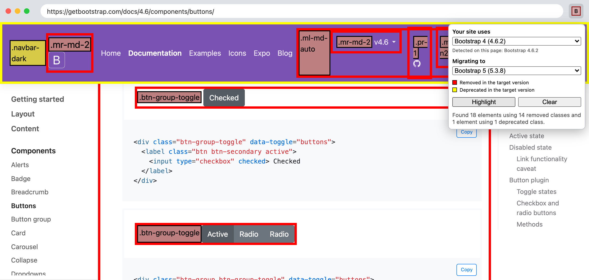

<h1 align="center"><picture><source media="(prefers-color-scheme: dark)" srcset=".github/logo-title-dark.svg"><source media="(prefers-color-scheme: light)" srcset=".github/logo-title-light.svg"></picture></h1>

  
Highlight Bootstrap deprecated classes.

  

    <a href="#installation"><strong>Install the extension »</strong></a>
     
     
    <a href="#installation">Installation</a>
    ·
    <a href="https://github.com/julien-deramond/bootstrap-deprecated-classes-extension/issues/new">Report a bug</a>
  

  

    
  

  
    

A browser extension highlighting [Bootstrap](https://getbootstrap.com/) deprecated classes in websites.

## Usage

Open a website using Bootstrap, click the extension icon, and pick two versions:

* **Your site uses**: the Bootstrap version of the website. It's preselected when the extension can detect it.
* **Migrating to**: the Bootstrap version you want to migrate to (Bootstrap 3 to 5, or the Bootstrap 6 alpha).

Click **Highlight** to outline in the page:

* in red, the classes of your version that don't exist anymore in the target version,
* in yellow, the classes that still work in the target version, but are deprecated and will be removed in the next major version.

The popup tells you how many elements and classes have been found. Changing a version updates the highlighting right away, and **Clear** removes it.

For instance:

* Bootstrap 4 → Bootstrap 5 shows what needs to change to migrate a Bootstrap 4 website to Bootstrap 5.
* Bootstrap 5 → Bootstrap 5 only shows the deprecated classes that you can already replace before Bootstrap 6.
* Bootstrap 5 → Bootstrap 6 alpha previews what a Bootstrap 6 migration would involve.

## Installation

You can install the extension directly from [Firefox Add-ons](https://addons.mozilla.org/firefox/addon/bootstrap-deprecated-classes/), [Chrome Web Store](https://chromewebstore.google.com/detail/bootstrap-deprecated-clas/cfkfbhnancjclhapldjkpllagfjpdihc), or [Microsoft Edge Add-ons](https://microsoftedge.microsoft.com/addons/detail/bootstrap-deprecated-clas/gldcnbcldiippdmakcdppaglkaofoobi).

### Locally

First, run `npm run build` to build the `dist` folder containing all the extension files.

For Firefox, `cd dist/firefox`, and then run:

* `web-ext run --devtools` to launch the extension in Firefox with DevTools.
* `web-ext run -u https://getbootstrap.com/docs/4.6` to launch the extension in Firefox with the Bootstrap 4 docs
* `web-ext lint` to check the extension for Firefox issues.
* `web-ext build` to build the extension for distribution that will be available in the `dist/firefox/web-ext-artifacts/` folder as a zip file.

For Chrome:
* please follow [Load an unpacked extension](https://developer.chrome.com/docs/extensions/mv3/getstarted/development-basics/#load-unpacked) instructions and load the `dist/chrome` folder.
* `cd dist/chrome`, and then run `web-ext build` to build the extension for distribution that will be available in the `dist/chrome/web-ext-artifacts/` folder as a zip file.

For Microsoft Edge:
* please follow [Sideload an extension](https://learn.microsoft.com/en-us/microsoft-edge/extensions-chromium/getting-started/extension-sideloading) instructions and load the `dist/edge` folder.
* `cd dist/edge`, and then run `web-ext build` to build the extension for distribution that will be available in the `dist/edge/web-ext-artifacts/` folder as a zip file.

## Data

Data is generated by running `npm run generate:data` and is stored in the `data` folder:
* `bootstrap-{$major}.json` contains the list of classes for the given Bootstrap major version (the latest release of this major version, or the pinned pre-release for the Bootstrap 6 alpha).
* `versions.json` contains the exact version used for each major version, and the list of its deprecated classes.

The removed classes are computed by the extension itself by comparing the classes of the two selected versions.

Please note that the deprecated classes are maintained manually in `script/build.mjs` since they can't be automatically detected. The Bootstrap 6 pre-release version is pinned in this file as well, and needs to be bumped for each new pre-release.

## Sponsors

  

## License

Licensed under the MIT License.

See [LICENSE](https://github.com/julien-deramond/bootstrap-deprecated-classes-extension/blob/main/LICENSE) for more information.
